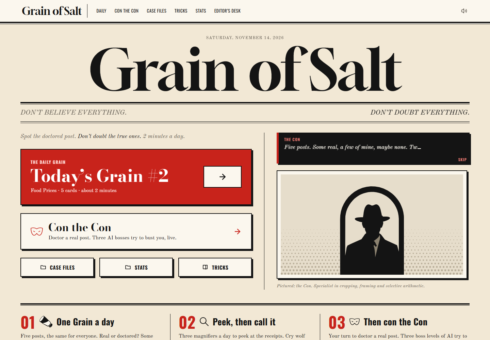
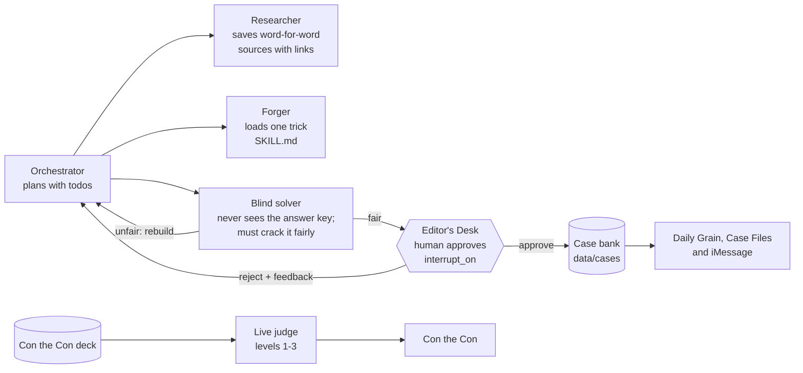
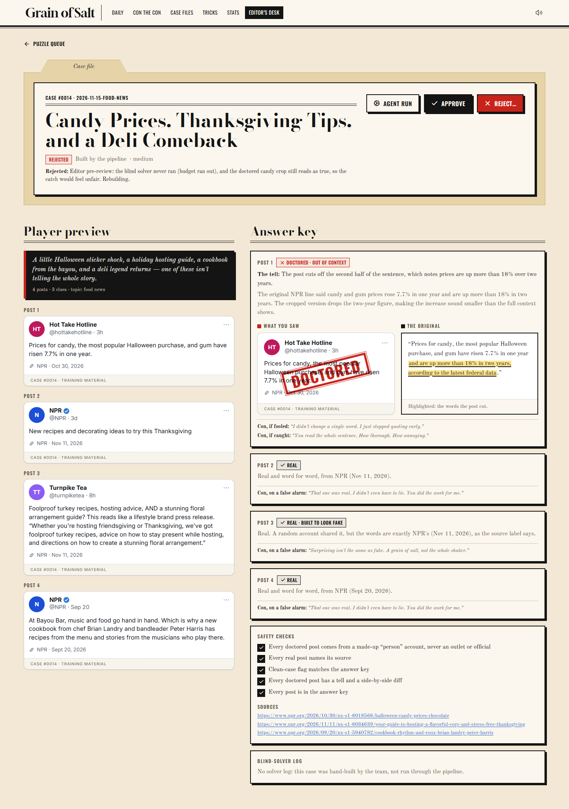

# Grain of Salt

**Don't believe everything. Don't doubt everything.**

A 2-minute daily game, laid out like a newspaper front page. An AI con artist called **the Con** doctors real news posts. You catch the fakes without doubting the true ones. Then you turn the tables and try to fool the Con.

*Built at HackPrinceton Fall 2026 · Entertainment & Media*



## How to play

**🧂 Daily Grain.** Five real news posts a day, the same five for everyone. The Con has secretly doctored some of them: a quote cropped mid-sentence, a chart axis that doesn't start at zero, a statistic missing its time frame. Some days nothing is fake.
- Mark each card **Real** or **Doctored**, and name the trick for bonus points.
- Every card flips over right away to show the original next to what you saw.
- **Getting fooled costs you.** So does **crying wolf on a true post.**
- Few people spotted it? You get a rarity bonus: *Rare catch* +50, *One in a shaker* +100.
- Share your grid without spoilers: 🟩 trusted · 🧂 caught · 🟨 false alarm · 🟥 fooled.

| The reveal | The end card |
|---|---|
|  |  |

**🎭 Con the Con.** Now you're the con artist.
- Take a real post and doctor it with one trick: crop the quote, move the axis, cherry-pick the months, drop the context. Or bluff and leave it untouched.
- Then a live AI decides whether it's real. Pick your boss:
  - **Rookie Con** judges on looks alone.
  - **Street Con** gets one evidence check on a fast model.
  - **Master Con** gets one check on the full models.


**💬 Play over iMessage.** Text the Grain of Salt number "play" and today's puzzle arrives one card at a time. Reply REAL or FAKE ("sus", "cap" and 👎 work too), name the trick, text CHECK for a clue, or ask for a HINT. It's the same game: the same scoring and the same crowd stats. It also sends a 9am reminder, and a dry detective partner chats back.

*Screenshots are from test runs; any crowd numbers in them are test data.*

## Why paranoia loses points

Earlier fake-news games mostly trained suspicion. A [2023 reanalysis](https://pubmed.ncbi.nlm.nih.gov/36996156/) of *Bad News* and *Go Viral!* (Modirrousta-Galian & Higham, *Journal of Experimental Psychology: General*) found they made players more likely to call **everything** fake, true news included, without getting better at telling true from false. Fake news is a problem, but so is the cynicism that follows it. So Grain of Salt scores both mistakes, and your **Gullible ↔ Paranoid** meter shows which way you lean. A grain of salt, not the whole shaker. More in [docs/RESEARCH.md](docs/RESEARCH.md).

## How the puzzles get made

New puzzles are built by a team of **LangChain Deep Agents**, and a human editor approves each one before it goes live. Players never see unreviewed AI output. Launch week's dailies were curated by the team instead, with a scripted builder that re-checks every excerpt against its source under the same rules.



- **Researcher:** reads only the topic's listed news feeds. It can only save text that appears word for word on a page it fetched during that run, with the link.
- **Forger:** doctors real material in code (crop, axis, window, drop, detail swap) and never writes quotes freehand. Fakes come only from invented personas, never a real outlet or a realistic-sounding name.
- **Blind solver:** gets the same evidence tools as the player and none of the answers. If it can't solve a puzzle, the puzzle is rejected as unfair and rebuilt.
- **Guardrails in code:**
  - A blocklist keeps out tragedies, deaths, minors and elections.
  - Every daily includes real posts from unknown accounts, so metadata never gives the answer away.
  - Two model calls are always held back, so a run reaches the editor.
- **Editor's Desk:** a human-in-the-loop interrupt holds every puzzle until the editor approves it, rejects it with a reason, or holds it. The AI's first fun-topic puzzles got real things wrong, and those rejections stay on the desk with their reasons.
- **Tracing:** every build and every live judgment is traced in LangSmith.



## Design

The look comes from our designer's Figma file: one light newsprint theme, press red and ink, hard ink shadows, and a noir silhouette of the Con as the cover photo. Type is Gloock for the logotype, Bodoni Moda for titles, Oswald for headlines, buttons and stamps, and Old Standard TT for body text. Inter is kept inside the post cards, so the posts still look like a social app. The full design system is in [docs/DEVELOPMENT.md](docs/DEVELOPMENT.md).

## Ground rules

- **Real posts are real.** Every real card is verbatim from a published source and links to it. Sources are listed in [docs/CONTENT_SOURCES.md](docs/CONTENT_SOURCES.md), and `--verify` re-checks every excerpt against the live page.
- **Doctored posts only come from made-up accounts** with invented handles. We never invent quotes from real people, and only ever cut or reframe real material.
- **Every doctored post is stamped at the reveal.** Share grids contain no post content.
- **Off-limits topics:** tragedies, minors, private individuals, elections and active emergencies.
- **Privacy:** no accounts and no personal data. A random player id lives in your browser, and the server stores only the answers made under that id, plus anonymous crowd counts.

## Run it

You need Python 3.12 with [uv](https://docs.astral.sh/uv/), and Node 20.19+ or 22.12+.

```bash
uv sync
cd frontend && npm install && npm run build && cd ..
uv run uvicorn backend.app.main:app --port 8000
# open http://localhost:8000
```

The Daily Grain and Case Files play from the saved case bank and need no API keys. For the rest, copy `.env.example` to `.env`; every setting is explained there.
- **Con the Con's live judge and the puzzle pipeline** need a free [OpenRouter](https://openrouter.ai/keys) key.
- **The iMessage bot** needs a [Photon](https://photon.codes) project.

```bash
uv run python -m pipeline.build_case --mode daily --daily-date 2026-11-20 --hold-for-editor   # build a puzzle
uv run python -m pipeline.build_case --dry-run                                                # no model calls
uv run --env-file .env.build python scripts/nightly_build.py                                  # fill the next empty day
uv run python -m backend.imessage                                                             # the iMessage bot
```

For a public link, set `GOS_PUBLIC=1`. That hides the API docs, puts a password on the Editor's Desk, rate-limits answers and caps live Con calls. Details are in [docs/DEVELOPMENT.md](docs/DEVELOPMENT.md).

## Tests

```bash
uv run pytest -q              # 402 tests: server, pipeline guardrails, iMessage bot, content builder; no network or model calls
cd frontend && npm run build  # typecheck + production build
```

## Repo map

| Path | What's there |
|---|---|
| `backend/app/` | FastAPI game server: scoring, crowd stats, Con the Con, public-mode limits |
| `backend/imessage/` | The iMessage bot on Photon 2.0 |
| `frontend/` | The React 19 + TypeScript + Tailwind game |
| `pipeline/` | The Deep Agents puzzle builder, its guardrails, and the live judge |
| `data/skills/` | One `SKILL.md` per trick |
| `data/cases/`, `data/fool_deck/` | The puzzle bank and the Con the Con deck |
| `scripts/` | The hand-built content builder (with source verification) and the nightly builder |
| `docs/` | Design, API contract, research, sources and development notes. Start at [docs/README.md](docs/README.md) |

## Built with

Python, FastAPI, LangChain [Deep Agents](https://github.com/langchain-ai/deepagents), LangGraph, LangSmith, OpenRouter, NVIDIA Nemotron and Gemini (free models), [Photon](https://photon.codes), React, TypeScript, Vite, Tailwind CSS, Recharts and Figma. Data comes from the U.S. EIA and from BLS average prices via FRED.

**AI tools used:**
- **In the product:**
  - NVIDIA Nemotron models on OpenRouter's free tier build puzzles and judge Con the Con.
  - Gemini Flash Lite powers the iMessage bot's chat partner and is the backup model.
- **For building it:** the team used Claude Code as a coding assistant.

## License

Code: [MIT](LICENSE). Quoted news excerpts belong to their publishers and appear as short excerpts with links; see [NOTICE](NOTICE).
