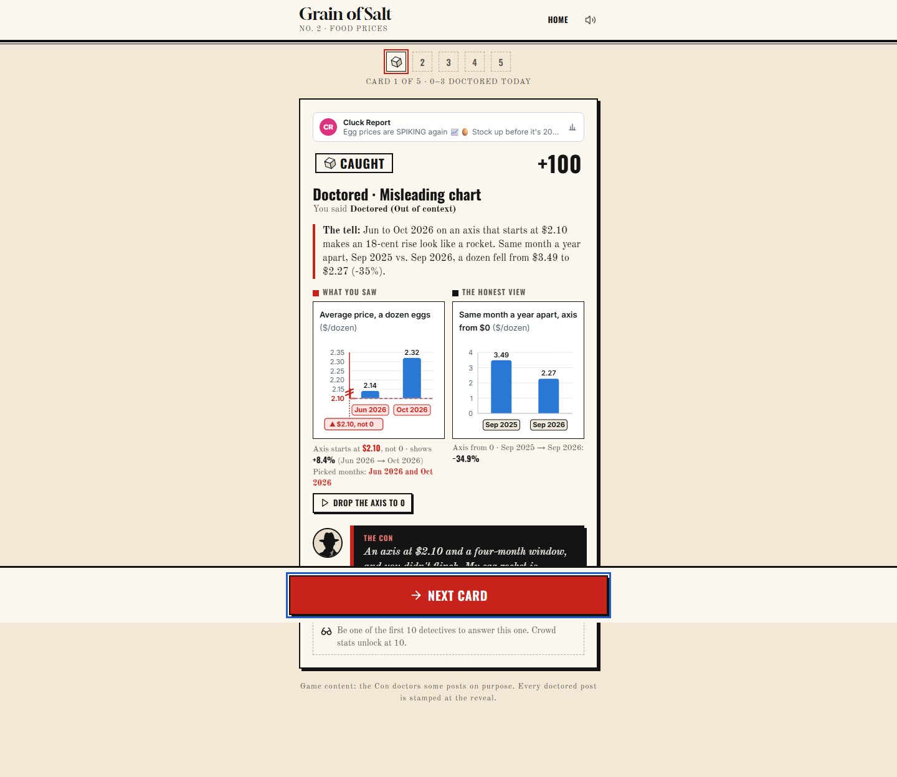
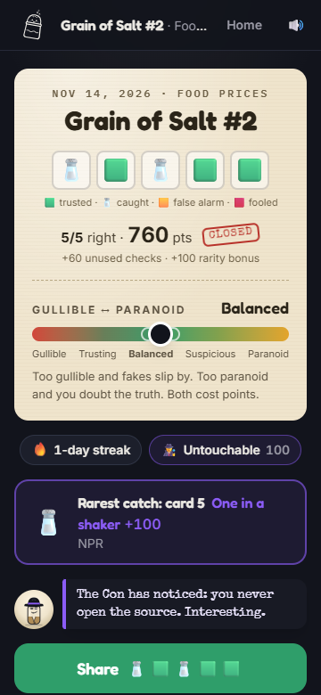
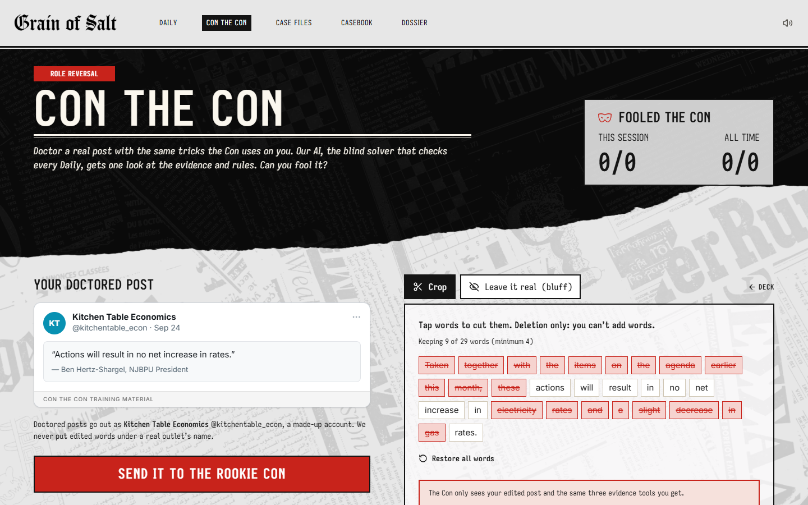
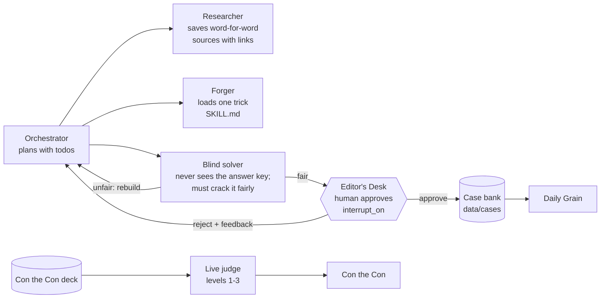

# Grain of Salt

**Don't believe everything. Don't doubt everything.**

A 2-minute daily game. An AI con artist called **the Con** doctors real news posts. You catch the fakes without doubting the true ones. Then you turn the tables and try to fool the Con.

*Built at HackPrinceton Fall 2026 · Entertainment & Media*


## How to play

**🧂 Daily Grain.** Five real news posts a day, the same five for everyone. The Con has secretly doctored some of them: a quote cropped mid-sentence, a chart axis that doesn't start at zero, a statistic missing its time frame. Some days nothing is fake.
- Tap **Real** or **Doctored**, and name the trick for bonus points.
- Every card flips over right away to show the original next to what you saw.
- **Getting fooled costs you.** So does **crying wolf on a true post.**
- Few people spotted it? You get a rarity bonus: *Rare catch* +50, *One in a shaker* +100.
- Share your grid without spoilers: 🟩 trusted · 🧂 caught · 🟨 false alarm · 🟥 fooled.

| The reveal | The end card |
|---|---|
|  |  |

**🎭 Con the Con.** Now you're the con artist.
- Take a real post and doctor it with one trick: crop the quote, move the axis, cherry-pick the months, drop the context. Or bluff and leave it untouched.
- Then a live AI decides whether it's real. Pick your boss:
  - **Rookie Con** judges on looks alone.
  - **Street Con** gets one evidence check on a fast model.
  - **Master Con** gets one check on the full models.



*Screenshots are from a test run; the crowd numbers in them are test data.*

## Why paranoia loses points

Earlier fake-news games mostly trained suspicion. A [2023 reanalysis](https://pubmed.ncbi.nlm.nih.gov/36996156/) of *Bad News* and *Go Viral!* (Modirrousta-Galian & Higham, *Journal of Experimental Psychology: General*) found they made players more likely to call **everything** fake, true news included, without getting better at telling true from false. So Grain of Salt scores both mistakes, and your **Gullible ↔ Paranoid** meter shows which way you lean. A grain of salt, not the whole shaker. More in [docs/RESEARCH.md](docs/RESEARCH.md).

## How the puzzles get made

New puzzles are built ahead of time by a team of **LangChain Deep Agents** and approved by a human puzzle editor. The game never shows unreviewed AI output. (Launch week's dailies were curated by the team with a scripted builder that checks every excerpt against its source, under the same rules.)



- **Researcher:** can only save text that appears word for word in a page it fetched during that run, with the URL.
- **Forger:** doctors real material in code (crop, axis, window, drop, detail swap). It never writes quotes freehand.
- **Blind solver:** gets the same evidence tools as the player and none of the answers. If it can't solve a puzzle, the puzzle is rejected as unfair and rebuilt.
- **Editor's Desk:** a human-in-the-loop interrupt holds every puzzle until the editor approves it, rejects it with feedback (the agents revise), or holds it.
- **Tracing:** every build and every live judgment is traced in LangSmith.

## Ground rules

- **Real posts are real.** Every real card is verbatim from a published source and links to it. Sources are listed in [docs/CONTENT_SOURCES.md](docs/CONTENT_SOURCES.md), and `--verify` re-checks every excerpt against the live page.
- **Doctored posts only come from made-up accounts** with invented handles. We never invent quotes from real people, and only ever cut or reframe real material.
- **Every doctored post is stamped at the reveal.** Share grids contain no post content.
- **Off-limits topics:** tragedies, minors, private individuals, elections and active emergencies.
- **Privacy:** no accounts and no personal data. A random player id lives in your browser. The server stores only the answers made under that id, plus anonymous crowd counts.

## Run it

You need Python 3.12 with [uv](https://docs.astral.sh/uv/) and Node 20.19+ or 22.12+.

```bash
uv sync
cd frontend && npm install && npm run build && cd ..
uv run uvicorn backend.app.main:app --port 8000
# open http://localhost:8000
```

The Daily Grain and Case Files play from the saved case bank and need no API keys. Con the Con's live judge and the puzzle pipeline need a free [OpenRouter](https://openrouter.ai/keys) key: copy `.env.example` to `.env` and fill it in. LangSmith tracing is optional.

```bash
uv run python -m pipeline.build_case --mode daily --daily-date 2026-11-20 --hold-for-teacher   # build a puzzle
uv run python -m pipeline.build_case --dry-run                                                 # no model calls
```

For a public deployment, set `GOS_PUBLIC=1`. That hides the API docs, puts a token on the Editor's Desk, rate-limits answers and caps live Con calls. Details are in [docs/DEVELOPMENT.md](docs/DEVELOPMENT.md).

## Tests

```bash
uv run pytest -q              # 299 tests: backend, pipeline, content builder; no network or model calls
cd frontend && npm run build  # typecheck + production build
```

## Repo map

| Path | What's there |
|---|---|
| `backend/app/` | FastAPI game server: scoring, crowd stats, Con the Con, public-mode limits |
| `frontend/` | React 19 + TypeScript + Tailwind game |
| `pipeline/` | Deep Agents puzzle builder, trick tools, live judge |
| `data/skills/` | One `SKILL.md` per trick |
| `data/cases/`, `data/fool_deck/` | The puzzle bank and the Con the Con deck |
| `scripts/` | Hand-built content builder with source verification |
| `docs/` | [Spec](docs/SPEC.md), [API contract](docs/CONTRACT.md), [research](docs/RESEARCH.md), [sources](docs/CONTENT_SOURCES.md), [development notes](docs/DEVELOPMENT.md), [pitch kit](docs/PITCH.md) |

## Built with

Python, FastAPI, LangChain [Deep Agents](https://github.com/langchain-ai/deepagents), LangGraph, LangSmith, OpenRouter, NVIDIA Nemotron (free models), React, TypeScript, Vite, Tailwind CSS and Recharts. Data comes from the U.S. EIA and from BLS average prices via FRED.

**AI tools used:**
- **In the product:** NVIDIA Nemotron models on OpenRouter's free tier build puzzles and judge Con the Con. Gemini is the backup.
- **For building it:** the team used Claude Code as a coding assistant.

## License

Code: [MIT](LICENSE). Quoted news excerpts belong to their publishers and appear as short excerpts with links; see [NOTICE](NOTICE).
